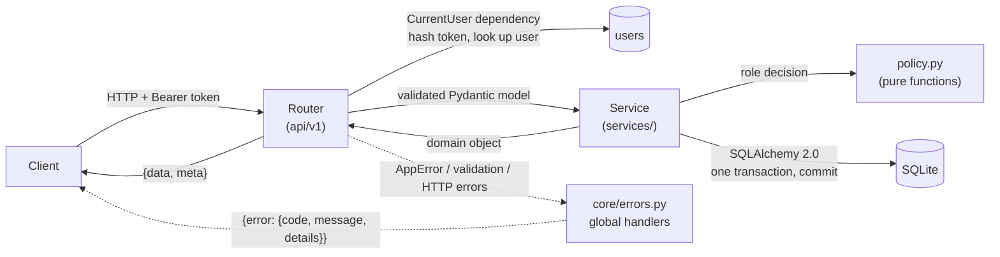
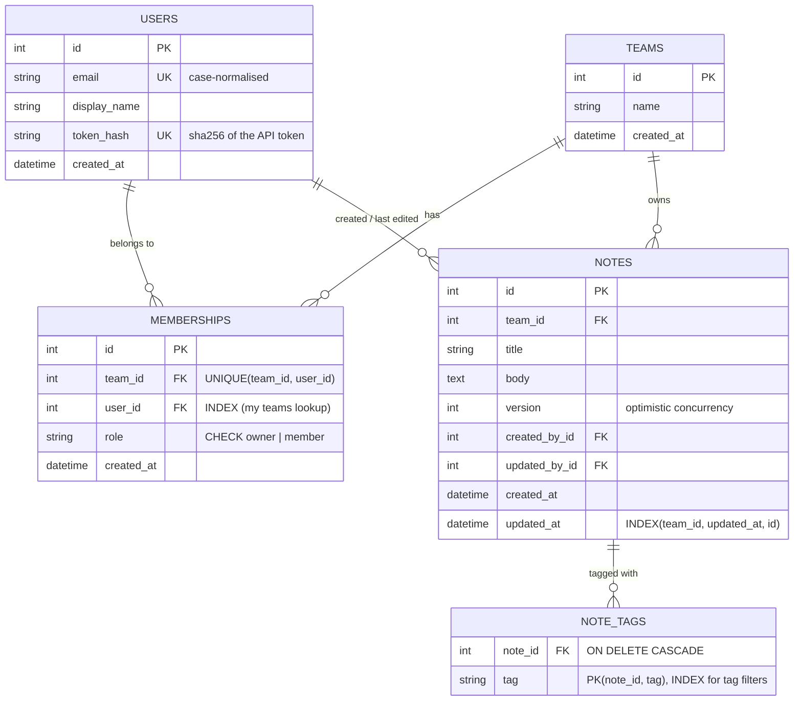
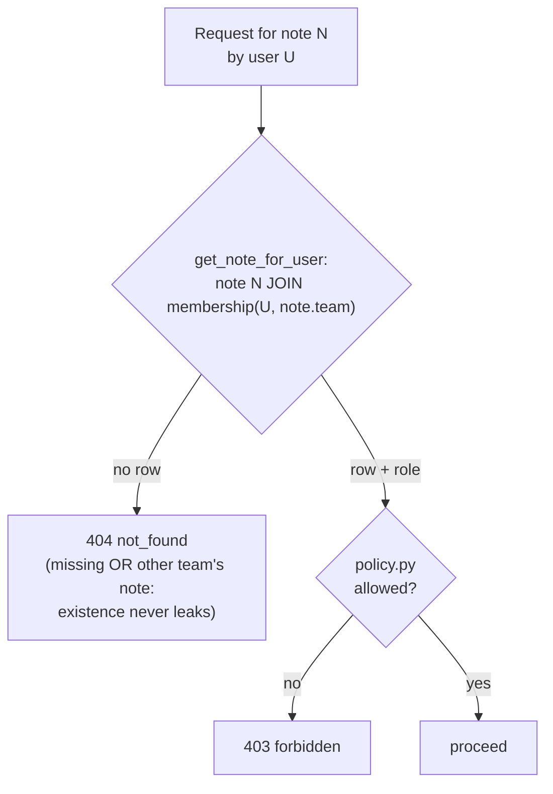
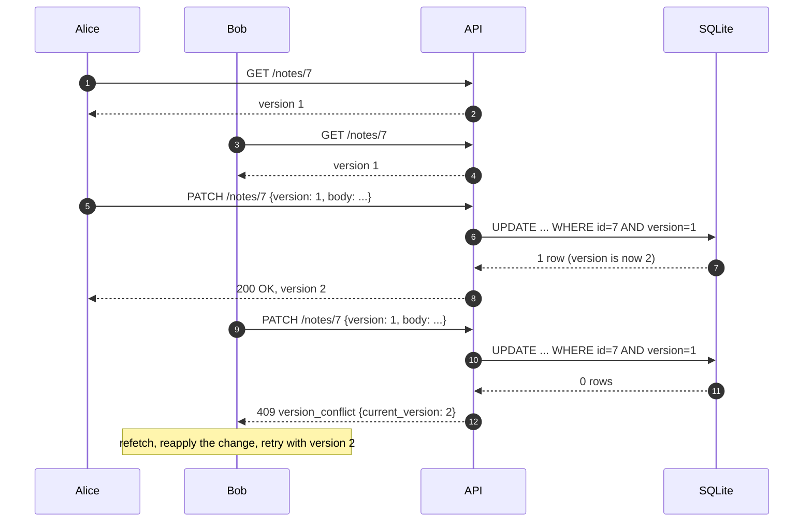

# Team Notes API

A REST backend for a note-taking service shared by small teams. Users belong to teams; each team keeps its own notes, which every member can capture, search, edit and organise with tags.

Built with **Python 3.12, FastAPI, Pydantic v2, SQLAlchemy 2.0 and SQLite**, managed with **[uv](https://docs.astral.sh/uv/)**.

---

## Quick start

```bash
# 1. Install uv (one-time): https://docs.astral.sh/uv/getting-started/installation/
curl -LsSf https://astral.sh/uv/install.sh | sh

# 2. Install dependencies (exact versions from uv.lock)
uv sync

# 3. Create or upgrade the database schema (./notes.db by default)
uv run alembic upgrade head

# 4. Run the API
uv run uvicorn team_notes_api.main:create_app --factory --reload

# 5. Run the tests
uv run pytest
```

### Run with Docker (no Python or uv needed)

```bash
docker compose up --build                                        # http://127.0.0.1:8000
docker compose -f compose.yaml -f compose.dev.yaml up --build    # dev: live reload on ./src
```

You can also run plain Docker: `docker build -t team-notes-api . && docker run --rm -p 8000:8000 -v team-notes-data:/data team-notes-api`.

The image:
- installs the exact versions from `uv.lock`;
- runs as a non-root user;
- keeps the SQLite file on the `/data` volume;
- applies pending migrations on start (`alembic upgrade head`) before serving;
- has a `HEALTHCHECK` on `/health`.

### Without uv

```bash
python3.12 -m venv .venv && . .venv/bin/activate
pip install -r requirements.txt            # generated from uv.lock with `uv export`
PYTHONPATH=src alembic upgrade head
PYTHONPATH=src uvicorn team_notes_api.main:create_app --factory
```

**API docs (OpenAPI):** interactive Swagger UI at <http://127.0.0.1:8000/docs>, ReDoc at `/redoc`, and the raw spec at `/openapi.json`. Use the **Authorize** button with the token from `POST /api/v1/users`.

## Configuration

Settings are loaded and validated by **pydantic-settings**, FastAPI's recommended approach, from `NOTES_*` environment variables and an optional `.env` file. Copy `.env.example` to `.env`; the real `.env` is git-ignored.

| Variable | Default | Meaning |
|---|---|---|
| `NOTES_DATABASE_URL` | `sqlite:///./notes.db` | Any SQLAlchemy URL |
| `NOTES_DEFAULT_PAGE_SIZE` | `20` | Page size when `limit` is omitted |
| `NOTES_MAX_PAGE_SIZE` | `100` | Lowers the page-size cap: a larger `limit` is clamped to it. The API itself rejects `limit` above 100 (422), so this can only reduce the cap, never raise it |
| `NOTES_CORS_ORIGINS` | *(empty)* | Comma-separated browser origins allowed to call the API. Empty means no cross-origin access. List explicit origins; don't use `*` |

**One image, many environments:** dev, staging and prod differ only in these values, following the twelve-factor convention. Real environment variables override `.env`, so Docker, compose and CI can inject per-environment values. The service holds no secrets today.

## Development checks

```bash
uv run pytest                                  # all tests
uv run ruff check src tests && uv run ruff format --check src tests
uv run lint-imports                            # architecture contracts (see below)
```

**import-linter** enforces the layering. These contracts fail the check if broken:
- `api` → `services` → `schemas` / `models`, never upward (`core` is shared infrastructure, outside the layers);
- `services.policy` stays pure: no database, models, API or other service imports;
- `models` never import `schemas`, `services` or `api`.

## Schema migrations

The schema is managed with **Alembic** (`migrations/`). The app never creates tables itself.

```bash
uv run alembic upgrade head                           # apply migrations
uv run alembic revision --autogenerate -m "describe"  # after changing a model; review the file
uv run alembic downgrade -1                           # step back one revision
```

- `migrations/env.py` reads the same `NOTES_DATABASE_URL` as the app and targets the models' metadata.
- It runs in SQLite **batch mode**, because SQLite can't `ALTER` most constraints in place.
- `tests/unit/test_migrations.py` upgrades an empty database to `head` and asserts **no drift** between the migrations and the models. It also round-trips `downgrade base`, then `upgrade head`. A model change without a migration fails the test suite.
- The test suite itself builds its throwaway databases from the models for speed. The drift test is what keeps that honest.

## Walkthrough (curl)

With the API running (see Quick start), this script needs `curl` and [`jq`](https://jqlang.org/). It creates two users and a team, then shows the 409 conflict when two people edit the same version of a note.

```bash
API=http://127.0.0.1:8000/api/v1

# Create two users; the token is shown ONCE
ALICE=$(curl -s -X POST $API/users -H 'Content-Type: application/json' \
  -d '{"email":"alice@example.com","display_name":"Alice"}' | jq -r .data.token)
BOB=$(curl -s -X POST $API/users -H 'Content-Type: application/json' \
  -d '{"email":"bob@example.com","display_name":"Bob"}' | jq -r .data.token)

# Alice creates a team (she becomes its owner) and adds Bob
TEAM=$(curl -s -X POST $API/teams -H "Authorization: Bearer $ALICE" \
  -H 'Content-Type: application/json' -d '{"name":"Platform"}' | jq -r .data.id)
curl -s -X POST $API/teams/$TEAM/members -H "Authorization: Bearer $ALICE" \
  -H 'Content-Type: application/json' -d '{"email":"bob@example.com"}'

# Alice writes a note
NOTE=$(curl -s -X POST $API/teams/$TEAM/notes -H "Authorization: Bearer $ALICE" \
  -H 'Content-Type: application/json' \
  -d '{"title":"On-call handover","body":"Rotate keys Friday","tags":["ops"]}' | jq -r .data.id)

# Both edit from version 1. The first edit wins; the second gets 409 instead of silently overwriting.
curl -s -X PATCH $API/notes/$NOTE -H "Authorization: Bearer $ALICE" \
  -H 'Content-Type: application/json' -d '{"version":1,"body":"Rotate keys Thursday"}'
curl -s -X PATCH $API/notes/$NOTE -H "Authorization: Bearer $BOB" \
  -H 'Content-Type: application/json' -d '{"version":1,"body":"Rotate keys Monday"}'
# -> 409 {"error":{"code":"version_conflict","details":{"current_version":2}, ...}}

# Search and filter within the team
curl -s "$API/teams/$TEAM/notes?q=keys&tag=ops&limit=10" -H "Authorization: Bearer $BOB"
```

## API

All endpoints except `/health` live under `/api/v1`. Authenticated endpoints take `Authorization: Bearer <token>`.

**Versioning:**
- The version is in the URL, and each version is its own package (`api/v1/`).
- Breaking changes ship as `/api/v2` next to it, while `v1` keeps working until it is deprecated.
- `/health` is deliberately unversioned: it is an operational probe, not part of the API contract.

| Method | Path | Who | Purpose |
|---|---|---|---|
| GET | `/health` | public | Liveness + database check |
| POST | `/users` | public | Create a user; returns the API token once |
| GET | `/users/me` | any user | Current user |
| POST | `/teams` | any user | Create a team (caller becomes owner) |
| GET | `/teams` | any user | Teams I belong to |
| GET | `/teams/{team_id}` | member | Team with its members |
| POST | `/teams/{team_id}/members` | owner | Add a member by email, optionally with `role` `owner` or `member` (default) |
| DELETE | `/teams/{team_id}/members/{user_id}` | owner, or self | Remove a member (the last owner cannot be removed) |
| POST | `/teams/{team_id}/notes` | member | Create a note (`201`, `Location` header) |
| GET | `/teams/{team_id}/notes` | member | List notes: `?q=` search, `?tag=` (repeatable, AND), `?limit=`, `?cursor=` |
| GET | `/notes/{note_id}` | member | Read a note |
| PATCH | `/notes/{note_id}` | member | Edit; requires the `version` you edited from |
| DELETE | `/notes/{note_id}` | creator or owner | Delete a note (`204`) |

**Responses:** all `/api/v1` responses are `{"data": ..., "meta": {...}}`, except `204 No Content`; `/health` returns a bare `{"status": "ok"}`. **Errors** always use one envelope, including unknown routes, wrong methods and validation failures: `{"error": {"code": "...", "message": "...", "details": {...}}}`.

| Status | When |
|---|---|
| 401 `unauthenticated` | Missing or invalid token |
| 403 `forbidden` | You can see the resource but your role does not allow the action |
| 404 `not_found` | It does not exist, **or** it belongs to a team you are not in |
| 409 `conflict` / `version_conflict` / `last_owner` | Duplicate, stale edit, or removing the last owner |
| 405 `method_not_allowed` | Wrong HTTP method for an existing path |
| 422 `validation_error` / `invalid_cursor` | Bad input |
| 500 `internal_error` | Unexpected failure; logged server-side, and no details are leaked to the client |

## Project layout

```
pyproject.toml       project metadata, dependencies, ruff / pytest / import-linter config
uv.lock              exact pinned dependency versions
requirements.txt     pip fallback, exported from uv.lock
.python-version      Python 3.12 for uv
alembic.ini          Alembic configuration (the database URL comes from NOTES_DATABASE_URL)
Dockerfile           image: uv.lock-pinned, non-root, runs migrations then the API
compose.yaml         docker compose service + /data volume (compose.dev.yaml adds live reload)
.env.example         every NOTES_* setting with its default
.dockerignore, .gitignore
migrations/          Alembic schema migrations
  env.py             reads the app's settings and models' metadata (SQLite batch mode)
  script.py.mako     template for new revisions
  versions/          versioned schema revisions (0001: initial schema)
src/team_notes_api/
  main.py            app factory: settings, database, routers, error handlers
  core/              cross-cutting infrastructure
    config.py        settings (NOTES_* environment variables)
    db.py            engine, SQLite pragmas, per-request session
    errors.py        typed errors + the single error envelope + global handlers
    security.py      token generation and hashing
    roles.py         the owner/member role enum (shared by models and policy)
  api/               thin HTTP layer
    deps.py          shared CurrentUser and pagination dependencies (version-agnostic)
    v1/              version 1 of the public API, mounted at /api/v1
      users.py  teams.py  notes.py   one APIRouter per area
  services/          business logic and all queries; transactions commit here
    policy.py        pure role rules (who may edit / delete / manage members)
  models/            SQLAlchemy models: users, teams, memberships, notes, tags
    types.py         UTCDateTime column type (timezone-aware UTC in and out)
  schemas/           Pydantic request/response models (kept separate from ORM models)
    common.py        success / error envelopes and pagination meta
tests/
  conftest.py        fresh app + temp SQLite file per test; factories for users, teams, notes
  unit/              pure logic: policy truth table, token security, cursors, migration drift
  api/               behaviour through HTTP: users, teams, notes CRUD / concurrency / listing,
                     errors, CORS, health
  authz/             authorization matrix (every route x every actor) + route-coverage gate
```

Routers only parse input, call a service and wrap the result. Services own the rules, the queries and the transaction. `policy.py` holds the role decisions as pure functions, so they are unit-tested as a truth table.

### Request flow



### Data model



## Design choices I spent the most time on

### 1. Team isolation is enforced by structure, not by convention

The real risk in a shared-notes service is one team reading another team's notes. Rather than remembering a check in every endpoint, there is exactly **one function that loads a note by id**. It joins the note to the caller's team membership, so a note you cannot see simply does not come back. Every read, edit and delete goes through it, and there is no other way to fetch a note.



- **404, not 403, for other teams' notes.** A 403 would confirm the note exists. Inside your own team, a role failure (for example deleting someone else's note as a non-owner) returns 403, because you can already see the note.
- **Request models reject unknown fields** (`extra="forbid"`). A PATCH cannot smuggle in `team_id` or `created_by`.
- **The rule is tested as a matrix and gated.** `tests/authz/test_authz_matrix.py` checks every route against no token, a bad token, a non-member, a member and an owner. A second test walks the app's routes and **fails if a new endpoint is not covered** by the matrix or explicitly marked public, so a future endpoint cannot quietly skip the check. A third scans the source and fails if anything outside `services/notes.py` queries notes, which backs the "only one way to load a note" claim.

### 2. Shared notes need protection from silent overwrites

Several people editing the same note is the normal case for team notes, and the naive "last write wins" silently destroys someone's work. Each note carries a `version`. An edit must send the version it started from, and the update is **one atomic statement**: `UPDATE notes SET ..., version = version + 1 WHERE id = ? AND team_id = ? AND version = ?`.



- If no row matched, the note is re-checked: it is either gone (404) or someone saved first (**409** with the `current_version`, so the client can refetch and retry).
- Doing the check inside the `UPDATE` rather than read-compare-write means two simultaneous edits cannot both pass. A test races 2, 3 and 4 threads that all edit from the same version and asserts exactly one 200, with every other thread getting 409. Swapping the conditional `UPDATE` for read-check-write makes the 3- and 4-thread cases fail. The 2-thread case alone can miss the race, which is why the test uses several sizes.
- **Body field vs `If-Match`:** the version travels in the JSON body because it is explicit, visible in the API docs and trivial to test. The HTTP-idiomatic alternative is an `ETag` with `If-Match` (412/428); mapping to it would be a thin adapter.
- **Not considered:** locking (bad for a notes UI) and merging (out of scope).

### 3. Listing: keyset pagination, tags and search

- **Pagination is keyset (cursor) based,** ordered by `(updated_at DESC, id DESC)`, the order a notes UI shows. The `id` tie-breaker keeps it stable when timestamps collide. A test pages through 25 notes with identical timestamps and checks for no gaps or duplicates.
  - **Why not offset:** offset pages shift when someone adds or edits a note mid-scroll, and get slower as the offset grows.
  - **Tradeoff:** because the sort key changes on edit, a note edited while you scroll can move past your cursor. Sorting by `created_at` would remove that at the cost of a less useful order. I chose the useful order and documented it.
- **Tags are a small child table,** not a JSON column, so they can be indexed and filtered portably on SQLite and Postgres. Each `?tag=` is an `EXISTS` subquery, so filtering never duplicates rows.
- **Search is a case-insensitive substring match** on title and body with wildcards escaped (`%` is literal). It is simple and correct for small teams. Its limits are no ranking, and SQLite's case folding is ASCII-only.

## Authentication: why an opaque token, not JWT or cookies

`POST /users` returns a random 256-bit token. It is shown once and stored only as a SHA-256 hash.

- **Not JWT.** These tokens are checked against the database, so deleting the row revokes one instantly. A JWT stays valid until it expires, unless you add a deny-list, which brings the database lookup back. JWTs also come from a login flow, with passwords, signing keys and refresh, which is real authentication and out of scope here.
- **Not session cookies.** The token is effectively a server-side session ID carried in a header. Cookies are sent automatically by browsers, so they need CSRF protection. A bearer header does not, and it works the same for scripts, mobile apps and services.
- **The swap point is one dependency** (`CurrentUser` in `api/deps.py`). Replacing it with OIDC/OAuth, or with `HttpOnly` cookie sessions for a first-party web app, touches nothing else.

## Known limitations (deliberate, for this scope)

- **Integer IDs are public.** Enumeration does not leak anything, because a note in another team returns the same 404 as a missing one. UUIDs would hide counts.
- **Team and member lists are not paginated,** on the assumption of small teams. Note lists are.
- **`limit` above 100 is rejected (422),** not silently clamped.
- **Email is syntax-validated, not verified.** Pydantic's `EmailStr` (via `email-validator`) checks the format without DNS lookups (and caps addresses at 254 characters, per the RFC), and addresses are normalised to lower case. No verification email is sent, so ownership of an address is not proven.
- **Search case-folding is ASCII-only,** which is SQLite's `LIKE`.
- **403 cannot happen on note read, create or edit,** because any team member may do those. 403 appears for deletes by non-creator members and for member management by non-owners.

## Scope: what I deliberately left out

The time box went to the core: team isolation, safe concurrent edits and listing. These were cut on purpose:

- **Real authentication** (see above). The stand-in token keeps the access rules real without building a login system.
- **Real-time collaboration.** Clients poll for now; the design is in "What I'd add".
- **Note history, restore and soft delete.** Deletes are permanent. The `version` counter is the hook a history table would hang off.
- **Sharing a note outside its team.** Teams are the only sharing boundary, which keeps the authorization model to a single rule.
- **Team and account management beyond the basics.** There is no endpoint to rename or delete a team, change a member's role, or edit or delete your own user.
- **Attachments and rich content.** Note bodies are plain text (Markdown works as plain text).
- **Rate limiting and abuse protection.**

## What I'd change or add with more time

- **Real authentication:** OIDC/OAuth or session login behind the same `CurrentUser` seam, plus token expiry and rotation.
- **Postgres in CI.** The code avoids SQLite-specific SQL and the database URL is one setting, so it is portable by construction, but **only SQLite is exercised today**.
- **Full-text search:** Postgres `tsvector`, or SQLite FTS5 with a query sanitiser, for ranking and better language handling.
- **Real-time updates:**
  - A per-team event stream (`/api/v1/teams/{team_id}/events`, as WebSocket or server-sent events) pushes `note.created`, `note.updated` and `note.deleted`.
  - It authenticates with the same token and team-membership check.
  - It is fed by Redis pub/sub or Postgres `LISTEN/NOTIFY`, so it keeps working across several replicas. An in-process hub would break the stateless design.
  - The existing `version` field already lets a client know when the note it is viewing went stale. I left this out of the time box because a half-working real-time layer is worse than none.
- **Note history:** keep prior versions, which pairs naturally with the version counter, and soft delete with restore.
- **`ETag` / `If-Match`** support alongside the body version.
- **Operational basics:** structured logging, request IDs, and a compose profile with Postgres for staging and prod.
- **Workers, Redis, queues: not yet, on purpose.**
  - Several Uvicorn workers would mostly queue behind SQLite's single writer, so they come after Postgres.
  - Nothing needs background jobs today. Every operation is a short write inside the request.
  - Redis becomes the right tool for three items in this list: rate limiting (shared counters), real-time fan-out (pub/sub) and a job queue, once there is background work.
- **Scaling out:**
  - The service is stateless: no in-memory sessions or caches, and auth is a token lookup. It can run as several replicas behind a load balancer as-is.
  - The limit today is SQLite's single writer. The next step is Postgres (the database URL is one setting) with connection pooling.
  - Listing already scales: keyset pagination over the `(team_id, updated_at, id)` index stays fast as teams accumulate notes, unlike offset paging.
  - API versioning (`/api/v1`) lets the contract evolve without breaking existing clients.

## How AI was used

This challenge allowed AI tools. I built it with **Khimaira**, my own multi-agent orchestration platform for Claude Code. The process was:

1. **Design, then adversarial review.** I set the requirements and the design: stack, scope, project layout, API versioning, uv, Alembic, Docker and the auth approach. A separate review agent then attacked the plan before any code existed. That review shaped the authorization matrix, the atomic versioned `UPDATE` and the keyset pagination.
2. **Implementation by a builder agent,** working in small, individually green commits. That is the history you see.
3. **Independent verification.** A separate reviewer agent audited the code from a fresh clone and held the submission back until gaps were fixed. One gap was that the concurrency test was sequential, so it now races real threads.

The tests check the claims in this README. The mutation-checked tests are the access matrix, the concurrency race, the layering contracts and the migration drift. I also exercised every endpoint by hand against the running service and the Docker container, and followed this README step by step from a fresh clone.
